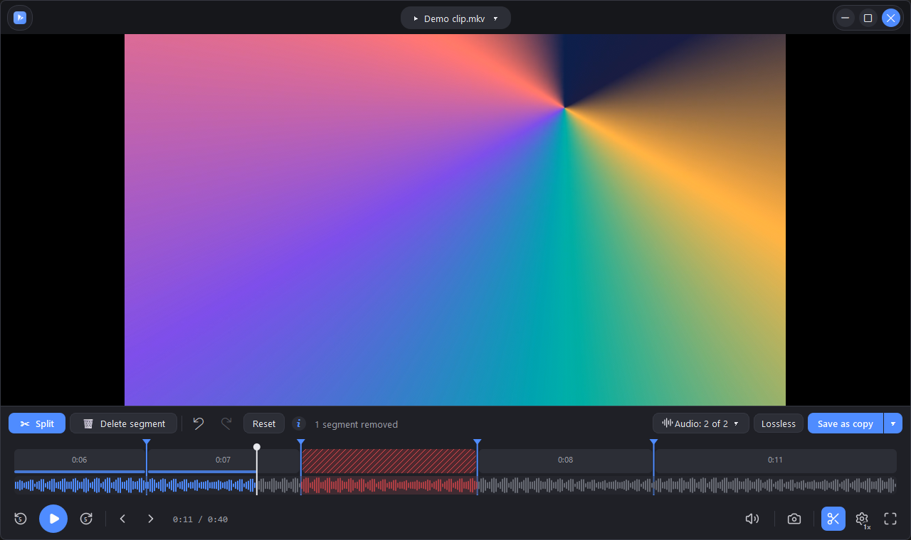
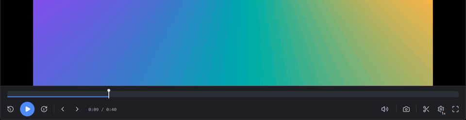
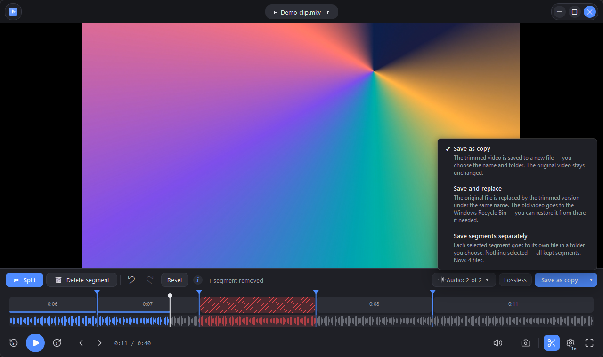
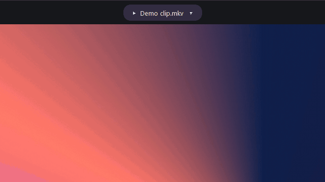
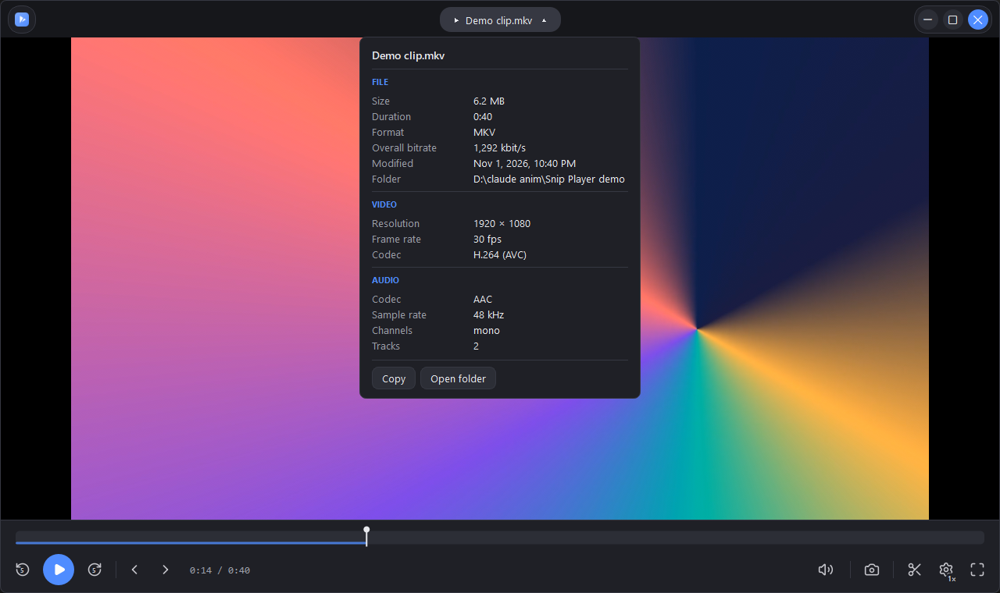
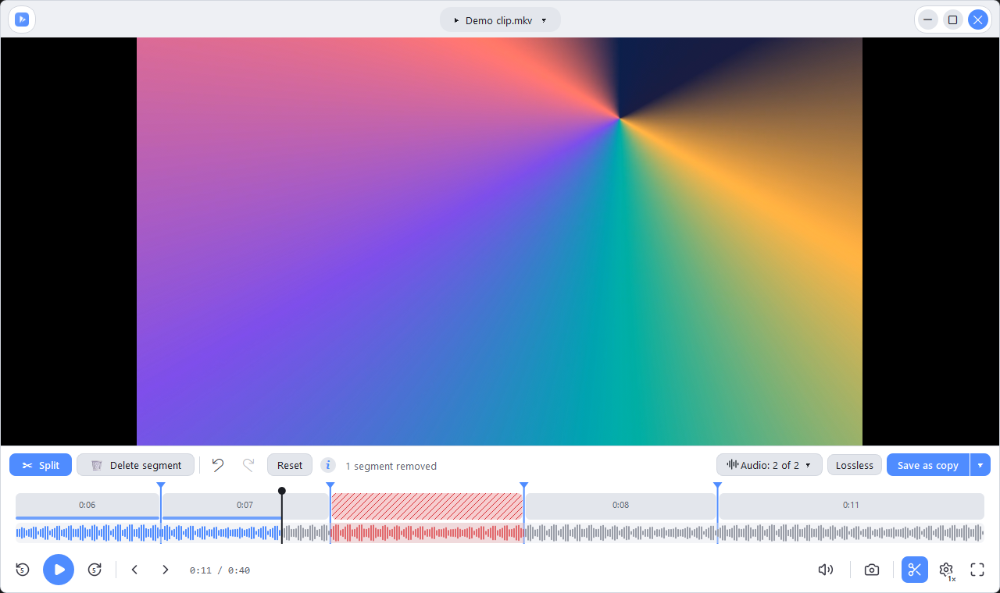
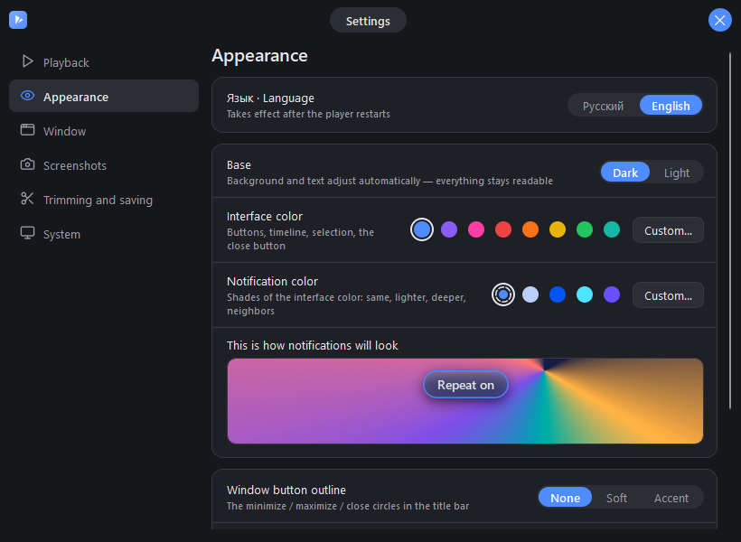
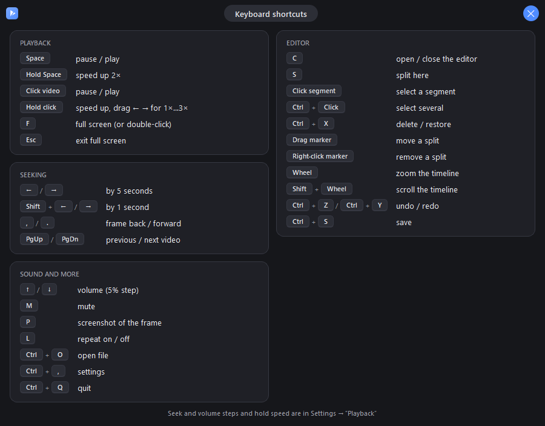

<div align="center">

# Snip Player

**A clean, fast video player for Windows with a built-in frame-accurate trimmer.**

Watch a video, cut out the parts you don't need and save the result — in the same window, in seconds,
without re-encoding the whole file.

[**⬇ Download for Windows**](../../releases/latest) · [**♥ Support the project**](https://donatex.gg/donate/absolo) · English / Русский · Free & open source (GPL-3.0)



</div>

## Why Snip Player

- **Trim without losing quality.** Cuts are exact to the frame, but only the few frames around each cut are
  re-encoded. Everything else is copied byte for byte, so even long recordings save quickly and look
  the same as the original.
- **Plays almost anything.** Uses the [mpv](https://mpv.io) engine: MP4, MKV, AVI, MOV, WebM, TS, WMV, FLV
  and more, smooth playback, instant seeking.
- **Made for recordings with several audio tracks.** OBS-style files with game, mic and Discord on separate
  tracks: listen to any track and choose which ones to keep when you save.
- **Portable, no installation.** Unzip and run. Python, Qt, mpv and FFmpeg are all inside the folder.
- **Looks good and feels responsive.** Custom title bar, dark and light themes, any accent color, smooth
  animations on every button.

## Download

1. Go to [**Releases**](../../releases/latest) and download `Snip-Player-…-win64.7z` (≈75 MB) or the `.zip`
   (≈145 MB, for Windows 10 without 7-Zip).
2. Unpack it anywhere — for example to `Documents` or a USB stick.
3. Run **`Snip Player.exe`**. The interface follows your Windows language (English or Russian) and can be
   switched in *Settings → Appearance*.

> Windows may show *"Windows protected your PC"* (SmartScreen) for apps that are not from the Store.
> Click **More info → Run anyway**.

**Requirements:** Windows 10 or 11, 64-bit. A graphics card is optional — it only speeds up saving.

## Features

### Trimming



- Press **C** (or the scissors) to open the editor right in the bottom panel — no separate window.
- **S** splits the video at the current frame; drag a marker to move the cut, right-click it to remove it.
- Select segments with a click (**Ctrl+click** for several) and press **Ctrl+X** / **Delete** to remove or
  restore them. Removed parts are hatched on the timeline and skipped during playback, so you see the
  result before saving.
- **Audio waveform** under the timeline makes it easy to cut on pauses and sounds.
- **Mouse wheel** zooms the timeline down to half a second per screen; **,** / **.** step frame by frame.
- Unlimited **undo / redo** (Ctrl+Z / Ctrl+Y).

### Saving



| | |
|---|---|
| **Lossless** (default) | Frame-accurate. Video between keyframes and all audio are copied untouched; only the frames from a cut to the nearest keyframe are re-encoded at visually lossless quality. The result is checked automatically (frame count, audio length, decoding at the joins). |
| **Fast** | Pure copy, almost instant; cuts snap to the nearest keyframes. |
| **Save as copy** | New file, the original stays as is. |
| **Save and replace** | The trimmed version takes the original name; the old file goes to the Recycle Bin. |
| **Save segments separately** | Every selected (or every kept) segment becomes its own file. |

Encoding uses your graphics card when possible (**NVIDIA NVENC, Intel Quick Sync, AMD AMF**) and falls back
to the CPU (x264 / x265). Choose which audio tracks end up in the file with the **Audio: 2 of 2 ▾** button;
their names are preserved.

### Playback

- **Hold the mouse button on the video or hold Space** — 2× speed while held; drag left/right for 1×…3×.
- Click — pause, double-click — full screen, **←/→** — seek 5 s, **Shift+←/→** — 1 s.
- **PgUp / PgDn** — previous / next video in the same folder.
- **P** — screenshot of the frame in full video resolution: saved to *Pictures\Snip Player* and copied to the
  clipboard (without flooding the Windows clipboard history).
- Repeat, always on top, playback speed, resume where you left off — in the ⚙ menu and Settings.
- One window: opening another video from Explorer sends it to the player that is already running.



### Video information

Click the file name at the top for format, resolution, frame rate, codecs, bitrates and audio tracks —
with *Copy* and *Open folder* buttons.



### Looks and settings



<table>
<tr>
<td></td>
<td></td>
</tr>
</table>

- Dark or light base, any interface color, separate notification color with live preview.
- Animated [Lucide](https://lucide.dev) icons, glassy on-screen notifications.
- Seek / volume steps, hold speed, end-of-video action, screenshot folder and format (PNG / JPG),
  GPU or CPU encoding, default quality and save mode.
- **Make it the video player** in *Settings → System* adds Snip Player to *Open with* for your user only —
  no administrator rights, and it can be removed with one button.
- Settings are stored in `settings.ini` next to the program (portable), or in `%APPDATA%\Snip Player`
  if that folder is read-only (e.g. *Program Files*).

## Keyboard shortcuts

| Key | Action | Key | Action |
|---|---|---|---|
| Space | play / pause | C | open / close the editor |
| Hold Space | 2× while held | S | split here |
| ← / → | seek 5 s | Ctrl+X, Delete | remove / restore segment |
| Shift+← / → | seek 1 s | Ctrl+Z / Ctrl+Y | undo / redo |
| , / . | previous / next frame | Ctrl+S | save |
| PgUp / PgDn | previous / next video | Wheel on timeline | zoom |
| ↑ / ↓ | volume | M | mute |
| F | full screen | P | screenshot |
| L | repeat | Ctrl+O | open file |
| Ctrl+, | settings | Ctrl+Q | quit |

## Running from source

```bat
git clone https://github.com/absolol/snip-player.git
cd snip-player
python -m pip install -r requirements.txt
```

1. Python 3.10+ (developed on 3.13), Windows.
2. Put `libmpv-2.dll` into `lib/` — see [lib/README.md](lib/README.md).
3. Install FFmpeg and make sure `ffmpeg` / `ffprobe` are in `PATH` (needed for saving and video info).
4. Run `python main.py [video]` or double-click `Запуск.bat`.

**Portable build:** `python сборка\build.py --7z --zip` (needs PyInstaller; FFmpeg from `сборка/ffmpeg/` or
`PATH`) produces the ready-to-run folder and archives.

<details>
<summary>Project structure</summary>

| Path | What it is |
|---|---|
| `main.py` | entry point, single-window hand-over, error log |
| `player/engine.py` | thin wrapper around libmpv |
| `player/main_window.py` | window, shortcuts, editor and saving logic |
| `player/timeline.py` | custom-drawn timeline: segments, markers, zoom, waveform |
| `player/editor.py` | cut list model with undo / redo |
| `player/exporter.py` | lossless smart cut and fast cut via FFmpeg, GPU / CPU encoders |
| `player/waveform.py`, `media_info.py` | waveform peaks and video info via FFmpeg / ffprobe |
| `player/settings_window.py`, `prefs.py` | settings window and stored preferences |
| `player/i18n.py`, `lang_en.py` | Russian / English interface |
| `player/anim_button.py`, `icons.py` | animated buttons and Lucide icons |
| `themes/` | colors (`*.json`) and the stylesheet template |
| `сборка/` | portable build: PyInstaller spec, `build.py`, readme and licenses for the package |

</details>

## Support the project

Snip Player is free and will stay free. If it saves you time, you can support its development with a donation:
**[donatex.gg/donate/absolo](https://donatex.gg/donate/absolo)** ♥

Bug reports and ideas are welcome too — open an [issue](../../issues).

## License

Snip Player is free software under the [GNU GPL v3](LICENSE).

It is built on great open-source projects:
[mpv](https://mpv.io) (GPL-2.0+),
[FFmpeg](https://ffmpeg.org) (GPL-3.0, [gyan.dev](https://www.gyan.dev/ffmpeg/builds/) build),
[Qt](https://www.qt.io) / [PySide6](https://doc.qt.io/qtforpython/) (LGPL-3.0),
[python-mpv](https://github.com/jaseg/python-mpv) (GPL-2.0+ / LGPL-2.1+),
[Lucide](https://lucide.dev) icons (ISC) and ideas from [Lucide Animated](https://lucide-animated.com) (MIT).
Full license texts are in [`licenses/`](licenses) and in the `Лицензии` folder of the download.
